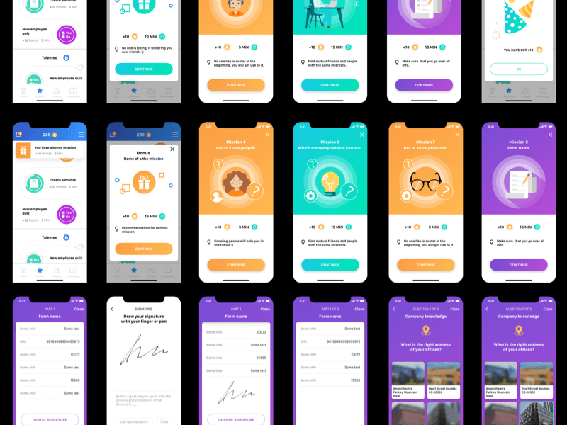
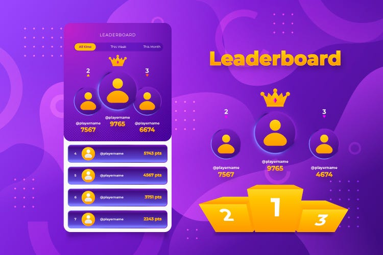
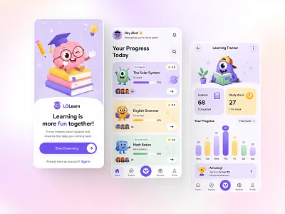
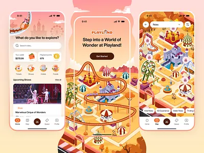

# تحلیل طراحی بصری و تصمیم Design System فانتینو

## ۱. نتیجه‌ی تصمیم

جهت نهایی طراحی فانتینو:

> **Playful Park؛ بازی‌وار، پرانرژی و خانوادگی، اما خوانا و حرفه‌ای برای والد و بزرگسال.**

از نمونه‌ها کپی مستقیم انجام نمی‌شود. ساختارهای موفق آن‌ها به Design System اختصاصی فانتینو تبدیل می‌شوند:

- از نمونه‌ی ۱: مأموریت‌های مرحله‌ای، کارت‌های رنگی و حس پیشرفت؛
- از نمونه‌ی ۴: کشف شعبه، فضای پارک و روایت تصویری مقصد؛
- از نمونه‌ی ۲: رتبه‌بندی و نمایش افتخار به‌عنوان قابلیت اختیاری؛
- از نمونه‌ی ۳: داشبورد آرام، سلسله‌مراتب اطلاعات و نمایش progress.

سطح کلی رابط مشتری باید روشن، دوستانه و لمسی باشد. بنفش و گرادیان فقط برای hero، مأموریت، پاداش یا حالت ویژه استفاده می‌شوند؛ پس‌زمینه‌ی تمام صفحات نباید دائماً اشباع و خسته‌کننده باشد.

## ۲. تحلیل تصاویر مرجع

### نمونه‌ی ۱ — Mission UI

**نقاط قوت**

- تفکیک روشن مراحل مأموریت؛
- استفاده از کارت، progress و CTA واضح؛
- رنگ متفاوت برای نوع یا وضعیت مأموریت؛
- مناسب برای تعامل‌های کوتاه و موبایلی.

**ریسک‌ها**

- اگر همه‌ی صفحات با همین اشباع رنگی ساخته شوند، خوانایی و تمرکز کم می‌شود؛
- برخی تصویرسازی‌ها بیشتر مناسب اپ منابع انسانی هستند تا شهربازی؛
- متن‌های سفید روی رنگ روشن ممکن است کنتراست کافی نداشته باشند.

**تصمیم فانتینو**

ساختار mission card، stepper، وضعیت پیشرفت و CTA حفظ می‌شود؛ تصویرسازی‌ها باید به جاذبه، خانواده و فضای فانتینو اختصاصی شوند.

### نمونه‌ی ۲ — Leaderboard

**نقاط قوت**

- ایجاد حس افتخار، رقابت و جایگاه؛
- hierarchy واضح برای رتبه‌های اول تا سوم؛
- مناسب برای کمپین یا رویداد محدود.

**ریسک‌ها**

- پس‌زمینه‌ی تمام‌صفحه‌ی بنفش برای استفاده‌ی روزمره سنگین است؛
- leaderboard عمومی می‌تواند برای کودک یا کاربر کم‌امتیاز فشار اجتماعی ایجاد کند؛
- نمایش نام و رتبه باید با حریم خصوصی و رضایت سازگار باشد.

**تصمیم فانتینو**

فقط برای رقابت دوستانه، هدف خانوادگی یا کمپین opt-in استفاده شود. رتبه‌بندی پیش‌فرض عمومی نیست و می‌تواند به‌صورت «پیشرفت من» یا رتبه‌ی ناشناس نمایش داده شود.

### نمونه‌ی ۳ — Learning Dashboard

**نقاط قوت**

- فضای سفید و آرام؛
- نمایش چند شاخص در کارت‌های کوچک؛
- progress قابل‌فهم و مناسب پیگیری روزانه؛
- hierarchy خوب برای داشبورد.

**ریسک‌ها**

- شخصیت آموزشی آن با شهربازی یکی نیست؛
- رنگ‌های پاستلی ممکن است برای وضعیت‌های عملیاتی یا هشدار کافی نباشند.

**تصمیم فانتینو**

منطق داشبورد، کارت‌های summary و نمایش پیشرفت استفاده می‌شود؛ موضوعات تصویری به خانواده، کارت، بازدید و مأموریت تغییر می‌کنند.

### نمونه‌ی ۴ — Theme Park Discovery

**نقاط قوت**

- پیوند مستقیم رابط با جهان واقعی پارک؛
- حس کشف، نقشه، جاذبه و انتخاب مقصد؛
- مناسب برای صفحه‌ی خانه و پیش از مراجعه؛
- رنگ و تصویرسازی دوستانه و قابل توسعه.

**ریسک‌ها**

- نقشه‌ی تصویری اگر با داده‌ی واقعی پشتیبانی نشود، صرفاً تزئینی می‌شود؛
- کارت‌های زیاد و فیلترهای زیاد می‌توانند صفحه‌ی کوچک را شلوغ کنند.

**تصمیم فانتینو**

از ایده‌ی کشف شعبه و جاذبه استفاده می‌شود، اما map فقط زمانی نمایش داده می‌شود که داده‌ی مکان، مسیر یا وضعیت واقعی داشته باشد. در غیر این صورت، کارت‌های مقصد و لیست قابل‌اسکن اولویت دارند.

## ۳. اصول بصری

1. **Fun without childishness:** انرژی و بازی‌واربودن برای همه‌ی سنین، بدون کودکانه‌کردن کل محصول.
2. **Progress over decoration:** هر رنگ، تصویر و animation باید به فهم وضعیت یا اقدام بعدی کمک کند.
3. **One primary action:** در هر کارت یا صفحه یک اقدام اصلی واضح باشد.
4. **Readable first:** فارسی، عدد، قیمت، زمان و وضعیت مالی از تزئین مهم‌ترند.
5. **Real-world trust:** اعتبار، پرداخت و وضعیت کارت با لحن دقیق و بدون اغراق نمایش داده شوند.
6. **Family-safe gamification:** رقابت و رتبه‌بندی opt-in، قابل‌کنترل و بدون شرمسارسازی باشد.
7. **Shared system, different density:** سه بستر از token مشترک استفاده کنند اما چگالی و tone آن‌ها یکسان نباشد.

## ۴. Design Tokens اولیه

### رنگ‌های معنایی

| token معنایی | مقدار اولیه | کاربرد                            |
| ------------ | ----------- | --------------------------------- |
| Ink          | #211A35     | متن اصلی و navigation تیره        |
| Brand Purple | #6D28D9     | هویت، مأموریت ویژه و لینک‌های مهم |
| Brand Teal   | #079A8A     | تأیید، بازی، اتصال و وضعیت زنده   |
| Brand Orange | #F59E0B     | امتیاز، پاداش و CTAهای پرانرژی    |
| Coral        | #F97316     | تأکید ثانویه و هشدار نرم          |
| Surface Warm | #FFF9F2     | زمینه‌ی اصلی مشتری                |
| Surface Cool | #F5F7FB     | زمینه‌ی پنل‌ها                    |
| Success      | #067A6F     | موفقیت با متن و آیکون همراه       |
| Danger       | #B42318     | خطا، برگشت و اقدام خطرناک         |
| Muted        | #667085     | متن کم‌اهمیت و metadata           |

مقدارهای بالا نقطه‌ی شروع‌اند، نه مجوز استفاده‌ی مستقیم در همه‌ی اجزا. component باید از token معنایی استفاده کند. متن سفید روی زرد/نارنجی روشن ممنوع است مگر کنتراست با آزمون accessibility تأیید شود.

### تایپوگرافی

- customer-web از `Estedad` نسخه‌ی `5.3.0` استفاده می‌کند؛ فرم نرم و هندسی آن برای تجربه‌ی صمیمی، بازی‌محور و موبایلی مشتری مناسب‌تر است.
- operations-web و system-web از `Vazirmatn` نسخه‌ی `5.3.0` استفاده می‌کنند؛ خوانایی، تراکم کنترل‌شده و تشخیص مناسب اعداد و داده‌های مدیریتی اولویت این دو پنل است.
- هر دو فونت با بسته‌ی دارای مجوز OFL و فایل‌های `woff2` در dependency محلی وارد می‌شوند؛ استفاده از Google Fonts یا CDN برای تایپوگرافی اصلی ممنوع است.
- fallback استاندارد sans-serif برای خرابی یا تأخیر غیرمنتظره‌ی asset تعریف می‌شود.
- تیترها وزن و فاصله‌ی کافی داشته باشند و با حروف لاتین یا عدد تراز خراب نشوند.
- اعداد مالی، امتیاز و زمان باید خوانا و قابل مقایسه باشند.
- از تمام‌حروف بزرگ انگلیسی در متن فارسی و از متن تزئینی ناخوانا استفاده نشود.
- line-height برای متن فارسی کمتر از مقدار خوانایی طراحی نشود.

### آیکون، حرکت و لایه‌ی بصری مشتری

- آیکون‌های customer-web با SVG داخلی و semantic name ساخته می‌شوند؛ emoji یا glyphهای وابسته به سیستم برای action، navigation و status مجاز نیستند.
- آیکون باید کنار متن یا در جایگاه بصری مشخص قرار بگیرد و نباید به‌صورت تصادفی زیر متن یا خارج از target لمسی بیاید.
- کارت‌ها و bottom navigation از glass layer با transparency، blur و border روشن استفاده می‌کنند تا از پس‌زمینه جدا بمانند؛ blur نباید خوانایی متن یا کنتراست action را کاهش دهد.
- حرکت‌های پایه شامل ورود تدریجی کارت، شناوری hero، twinkle برای نقاط تأکیدی و pop شدن منوی پایین است؛ حرکت تزئینی نباید وضعیت یا اقدام را پنهان کند.
- `prefers-reduced-motion` باید همه‌ی حرکت‌های غیرضروری را خاموش یا حداقل کند.

### فاصله و شکل

- سیستم فاصله بر مبنای گام ۴ و ۸؛
- شعاع بزرگ برای کارت و hero، شعاع متوسط برای کنترل‌ها؛
- سایه‌ی نرم و محدود، نه سایه‌ی سنگین روی همه‌ی کارت‌ها؛
- دکمه‌ی اصلی حداقل target لمسی مناسب و ناحیه‌ی قابل‌لمس مستقل داشته باشد؛
- در RTL ترتیب بصری، آیکون و جهت progress با معنا هماهنگ باشد.

## ۵. ساختار تجربه‌ی مشتری

### Shell موبایل

- header کوتاه با انتخاب شعبه، اعلان و وضعیت اتصال؛
- پس از ورود فقط یک هدر مرکزی و داینامیک نمایش داده می‌شود؛ لوگو و عنوان/توضیح متناسب با route همان صفحه در همین هدر قرار می‌گیرد و هدر ورود امن تکرار نمی‌شود؛
- محتوای scrollable با فاصله‌ی امن از bottom navigation؛
- bottom navigation پنج‌گزینه‌ای: خانه، کارت‌ها، مأموریت‌ها، خانواده، حساب؛
- bottom sheet برای انتخاب شعبه، فیلتر و اقدام‌های کم‌خطر؛
- modal فقط برای تصمیم مهم یا تأیید، نه برای هر پیام ساده.

### صفحه‌ی خانه

ترتیب پیشنهادی:

1. سلام و وضعیت شعبه‌ی انتخاب‌شده؛
2. کارت اقدام اصلی امروز؛
3. خلاصه‌ی کارت/اعتبار با زمان آخرین همگام‌سازی؛
4. جاذبه‌ها و پیشنهادهای قابل‌کشف؛
5. مأموریت فعال خانواده؛
6. رویدادها و راهنمایی کوتاه.

صفحه‌ی خانه نباید به dashboard شلوغ تبدیل شود. برای کاربر تازه‌وارد، یک مسیر واضح «از اینجا شروع کن» لازم است.

### کارت و کیف پول

- اعتبار پرداختی، هدیه و امتیاز با label جدا؛
- وضعیت stale، در حال همگام‌سازی، خطا و بدون اتصال مشخص؛
- تاریخچه به‌صورت timeline یا گروه روزانه؛
- مبلغ، زمان، شعبه و نوع رویداد واضح؛
- دکمه‌ی شارژ فقط در صورت فعال و تأییدشده بودن مسیر مالی.

### مأموریت

- نوع مأموریت با رنگ و icon مشخص، نه فقط رنگ؛
- شرط، زمان اعتبار، جایزه و پیشرفت در یک نگاه؛
- CTA اصلی واحد؛
- حالت locked، active، completed، expired و unavailable؛
- نمایش پاداش پیش از شروع و جلوگیری از claim دوباره.

### خانواده

- کارت عضو با نام نمایشی، رابطه، avatar اختیاری و سطح دسترسی؛
- تغییر context عضو با نشانه‌ی واضح؛
- اطلاعات کودک کمتر و کنترل والد بیشتر؛
- اعمال حساس با تأیید والد و پیام قابل‌فهم.

## ۶. تفاوت بصری سه بستر

| بستر       | لحن                                | چگالی         | استفاده از رنگ                      |
| ---------- | ---------------------------------- | ------------- | ----------------------------------- |
| مشتری      | دوستانه، اکتشافی، انگیزه‌بخش       | کم تا متوسط   | رنگ برند و illustration بیشتر       |
| مجموعه/شعب | سریع، دقیق، عملیاتی                | متوسط تا زیاد | رنگ معنایی برای وضعیت و خطا         |
| سیستم      | کنترل‌شده، قابل‌اعتماد، ممیزی‌محور | زیاد اما منظم | رنگ محدود و reserved برای خطر/وضعیت |

پنل‌ها نباید صرفاً نسخه‌ی desktop شده‌ی اپ مشتری باشند. component مشترک است، اما navigation، جدول، فیلتر، density و سطح تأیید متفاوت است.

## ۷. Componentهای پایه

### مشترک

- Button، IconButton، Link؛
- Input، Select، Combobox، Date/Time picker؛ تاریخ تولد در فرم به‌صورت یک فیلد متنی بازشونده نمایش داده می‌شود و تقویم شمسی در لایه‌ی انتخاب تاریخ باز می‌شود.
- Dialog، Drawer، Bottom Sheet، Toast؛
- Tabs، Segmented Control، Breadcrumb؛
- Table، List، Card، Empty State، Skeleton؛
- Alert، Badge، Status، Tooltip؛
- Pagination، Filter Bar و Search.

### مشتری

- BranchSwitcher؛
- BalanceCard؛
- CardStatus؛
- FamilyMemberCard؛
- MissionCard و MissionProgress؛
- RewardCard؛
- AttractionCard؛
- VisitPassport؛
- RealtimeStatus.

### پنل عملیاتی

- BranchScopeSelector؛
- CashierActionPanel؛
- CardLookup؛
- DeviceStatusGrid؛
- SalesSummary؛
- CampaignEditor؛
- AuditTimeline.

### پنل سیستمی

- OrganizationTree؛
- PermissionMatrix؛
- IntegrationHealth؛
- EventDeliveryStatus؛
- AdminActionConfirm؛
- SystemAuditTable؛
- FeatureFlagPanel.

هر component باید یک مسئولیت مشخص، حالت‌های کامل و تست accessibility داشته باشد. component نمایشی نباید منطق مالی یا مجوز را مالک شود.

## ۸. حرکت و بازخورد

- motion کوتاه، هدفمند و قابل خاموش‌کردن؛
- انیمیشن موفقیت برای تکمیل مأموریت، نه برای هر کلیک؛
- احترام به prefers-reduced-motion؛
- loading با skeleton یا progress واقعی، نه spinner نامحدود؛
- خطا با توضیح و اقدام بعدی، نه فقط رنگ قرمز؛
- تغییر زنده با indicator ظریف و قابل‌فهم.

## ۹. تصاویر و دارایی‌ها

- چهار تصویر مرجع فقط الهام طراحی هستند و نباید بدون بررسی مجوز وارد محصول شوند.
- عکس شعبه و جاذبه باید واقعی، به‌روز، بهینه و دارای متن جایگزین باشد.
- تصویرسازی کودک و avatar نباید اطلاعات هویتی حساس یا کلیشه‌ی جنسیتی غیرضروری تحمیل کند.
- هر تصویر hero باید mobile crop مستقل داشته باشد.
- هیچ تصویر تزئینی نباید مانع خواندن قیمت، اعتبار یا وضعیت شود.

## ۱۰. معیار پذیرش بصری

یک صفحه فقط وقتی آماده است که:

- در عرض‌های موبایل رایج و RTL بررسی شده باشد؛
- حالت loading، empty، error، stale و success داشته باشد؛
- focus keyboard و screen reader labelهای لازم را داشته باشد؛
- رنگ‌ها و متن‌ها از نظر کنتراست بررسی شده باشند؛
- اقدام اصلی در نگاه اول مشخص باشد؛
- در شبکه‌ی ضعیف layout shift و تصویر سنگین نداشته باشد؛
- با tokenهای Design System ساخته شده باشد، نه رنگ و فاصله‌ی پراکنده؛
- برای نقش و scope اشتباه داده نشان ندهد.
